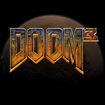
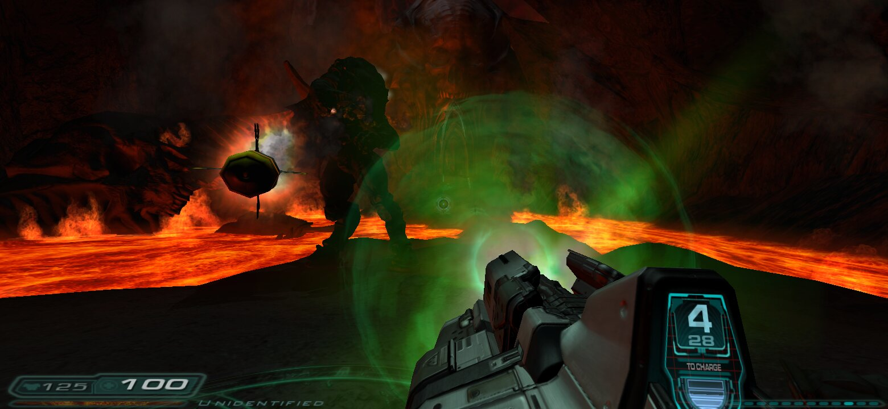
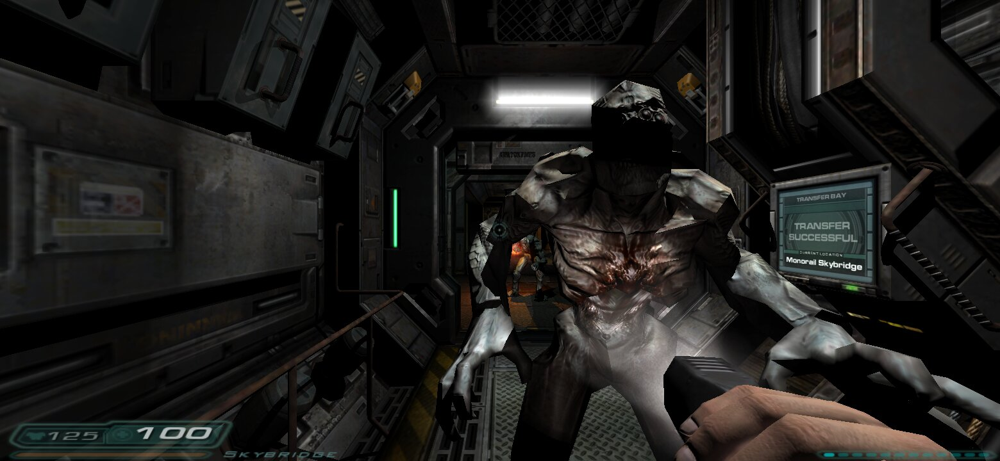
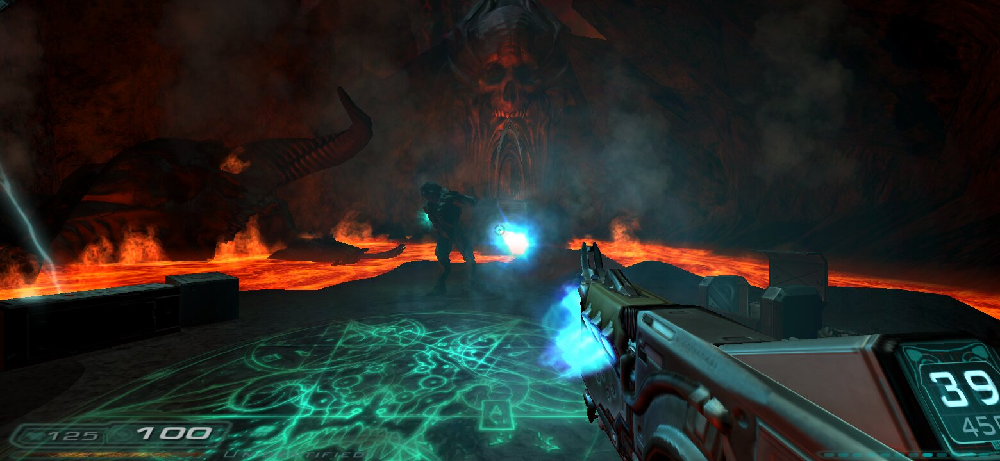
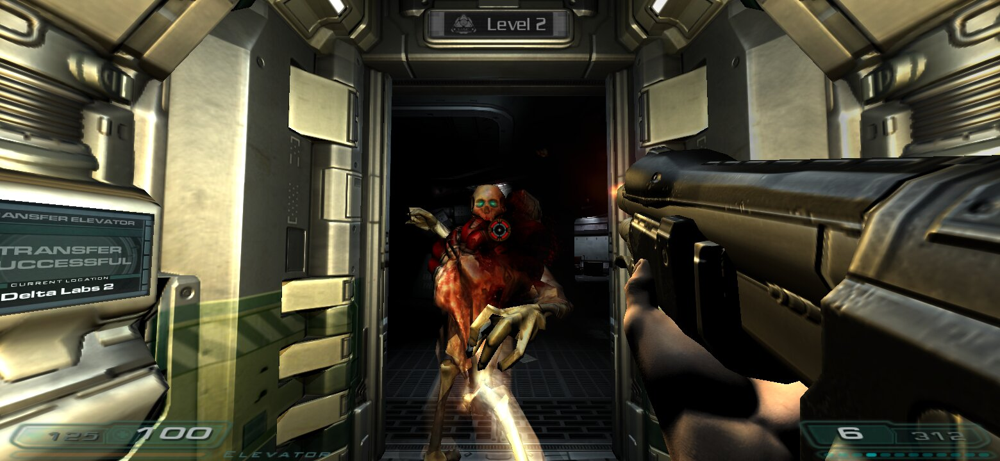
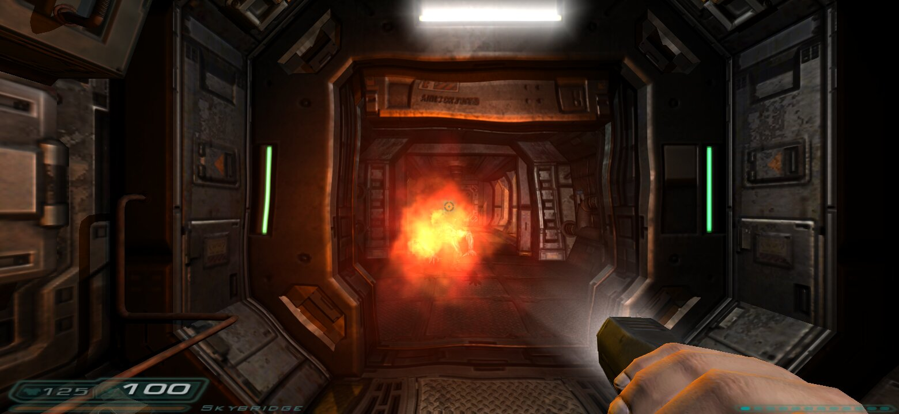
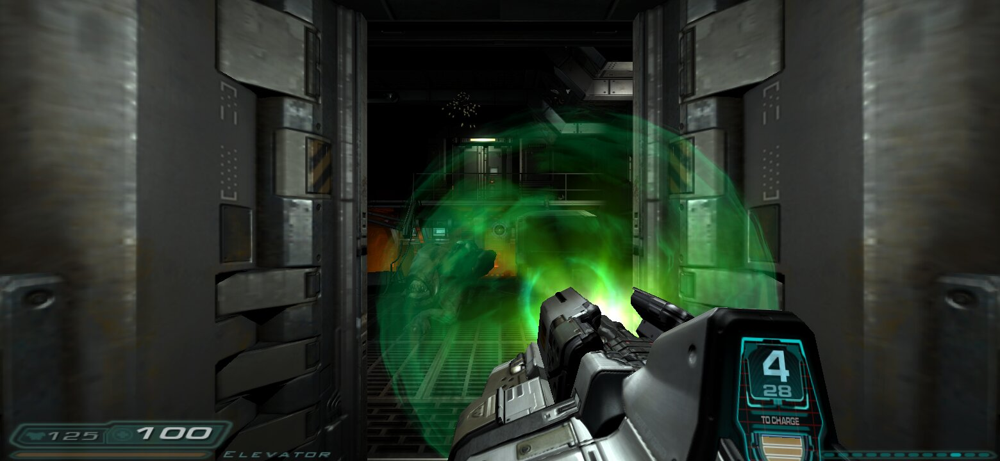
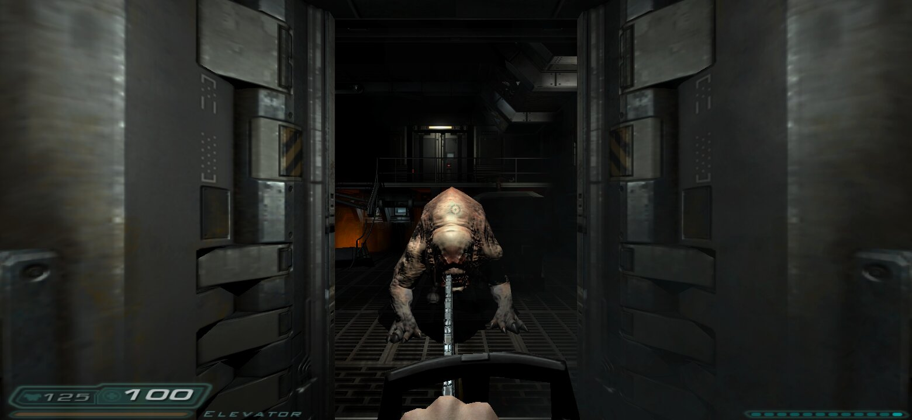

# DOOM 3 for iPhone and iPad (dhewm3)

Play the original **DOOM 3** (2004) and its expansion, **Resurrection of Evil**, on your iPhone, with touch controls made for it. It's an unofficial port of [dhewm3](https://dhewm3.org), the open-source DOOM 3 engine.



**You need your own copy of the game (Steam or GOG). Game files are not included.** Buy DOOM 3 on [Steam](https://store.steampowered.com/app/208200/DOOM_3/) or [GOG](https://www.gog.com/game/doom_3): both come with the original 2004 game and Resurrection of Evil, next to the *BFG Edition*. Only the original's files work here. Then copy them to your iPhone.

## Install

You need an iPhone with iOS 18 or newer (iPhone XS, XR or newer). The app isn't on the App Store, so you install it yourself ("sideloading"). Pick one way:

- **SideStore or AltStore (easiest).** On your iPhone, tap **[Add to SideStore](https://sithewok13-dev.github.io/doom3/#add-sidestore)** or **[Add to AltStore](https://sithewok13-dev.github.io/doom3/#add-altstore)**, then install **DOOM 3** from there. Updates come the same way.
- **Feather, Sideloadly or another signing tool.** Download `DOOM3-iOS-unsigned.ipa` from the [releases page](https://github.com/sithewok13-dev/doom3-ios/releases) and sign it with your tool.
- **The source by hand.** In SideStore, AltStore or Feather, go to *Sources*, tap **+**, and paste this address:

  ```
  https://raw.githubusercontent.com/sithewok13-dev/doom3-ios/ios/altsource.json
  ```

Then open the app once, and copy your game files into the Files app, in **On My iPhone > DOOM 3**:

- DOOM 3: the nine files `pak000.pk4` to `pak008.pk4` from the game's `base` folder, into `base`
- Resurrection of Evil (optional): `pak000.pk4` and `pak001.pk4` from its `d3xp` folder, into `d3xp`; then pick it under **MODS** in the main menu

The release notes have the full guide, step by step, and every control explained.

## Cool features

- **Touch controls made for DOOM 3:** a move stick wherever your left thumb lands, with a run marker above it; drag anywhere else to look; FIRE with JUMP, CROUCH, RELOAD and the flashlight round it.
- **A weapon wheel:** slide off NEXT WPN and every weapon is there, with its ammo.
- **Tilt aiming (gyro)**, a look speed to suit your thumb, SAVE and LOAD that open the game's own pages with a tap and quick save or load with a short hold, and an OPACITY slider for the buttons.
- **CAMERA:** photos of the game without the HUD, selfies, bursts, **Action Freeze** (stop the world and fly a camera round it) and a **cinematic burst** that sweeps round you. They go to your Photos app.
- **The PDA by touch:** tap to click, drag to scroll the emails and logs.
- **Both games in one app,** with a main menu laid out for the phone.
- **Cheat mode** for a relaxed run: god mode, every weapon with endless ammo, a cheat menu (Noclip, Notarget, Slow motion), and a list of every level to jump to.
- **Multiplayer and co-op** (from [LibreCoop](https://github.com/Stradex/librecoop)), on the same Wi-Fi or by address. Not tested yet: see below.
- **Sound with the phone on silent,** as a game should be.

## Sorry about the bugs

This is an unofficial beta, made by a fan and played by very few people so far. Expect bugs, and save often.

**Multiplayer and co-op have never been tried between two phones**, so they may well not work yet. Sorry: that's next to be tested and fixed. Single player is what has been played. iPads and game controllers haven't been tried either.

Found a bug? [Report it here](https://github.com/sithewok13-dev/doom3-ios/issues), not to dhewm3 or LibreCoop. Every report helps.

<p>






</p>

*All from the game running on a computer, with the game's own files, so they show no touch controls.*

## Thanks

This app stands on other people's generous work:

- **id Software**, who made DOOM 3 and released its source code under the GPL in 2011 ([id-Software/DOOM-3](https://github.com/id-Software/DOOM-3)).
- **Daniel Gibson and the dhewm3 contributors**, who have kept that code running on today's computers for over a decade ([dhewm3](https://github.com/dhewm/dhewm3)). This app is dhewm3 1.5.5 underneath.
- **Tom Kidd** ([tomkidd](https://github.com/tomkidd)), whose [DOOM3-iOS](https://github.com/tomkidd/DOOM3-iOS) this repository was forked from, with contributions from Dave Nicolson and Yoshi Sugawara. Its OpenGL ES renderer still draws the game here.
- **Gabriel Cuvillier**, for [d3wasm](https://github.com/gabrielcuvillier/d3wasm), DOOM 3 in a web browser, whose OpenGL ES work that renderer shares.
- **Stradex**, for [LibreCoop](https://github.com/Stradex/librecoop), the co-op and survival modes.
- The people behind [SDL](https://www.libsdl.org), [OpenAL Soft](https://openal-soft.org) and [ANGLE](https://chromium.googlesource.com/angle/angle).

Not affiliated with or endorsed by id Software, Bethesda Softworks, ZeniMax Media or Microsoft, and not an official dhewm3 release. DOOM is a trademark of its owners.

---

*The rest of this page is for people who want to build the app themselves.*

## Building

GitHub Actions builds it on every push to `ios` (`.github/workflows/ios.yml`) and
keeps an unsigned `DOOM3-iOS-unsigned.ipa` with each run, for sideloading or for
TestFlight through ios-pipeline. To build on a Mac with Xcode, CMake and Ninja:

```sh
ios/build-deps.sh                      # SDL3 and OpenAL Soft for iOS, into build-ios-deps/
cmake -S dhewm3/neo -B build-ios -G Ninja --toolchain ios/toolchain.cmake \
      -DCMAKE_BUILD_TYPE=Release \
      -DCMAKE_PREFIX_PATH=$PWD/build-ios-deps -DCMAKE_FIND_ROOT_PATH=$PWD/build-ios-deps
cmake --build build-ios                # build-ios/DOOM3.app
```

## What's where

- `dhewm3/`: dhewm3 1.5.5 (imported unmodified, then changed in later commits)
  with the OpenGL ES renderer and the iOS system code (`neo/sys/ios/`)
- `ios/`: the app around it: Info.plist, icons, the first-launch screen, the
  touch controls, finding Wi-Fi games, the dependency build
- `librecoop/`: [LibreCoop](https://github.com/Stradex/librecoop) (co-op and
  survival for both games), imported at the version in `librecoop/UPSTREAM`,
  with the touch controls' hooks added to its player code; its game code is
  linked in, and its mod folders (its own defs, scripts and strings) come in
  the app and are put in Documents, where the Mods menu has them. Its string
  tables are cut down to LibreCoop's own lines (the game-type lists with Coop
  and Survival); the rest of the game's text comes from your own files
- `docs/ios/PLAN.md`: the plan and the decisions made so far

The code is GPLv3, like the DOOM 3 source. Credits and thanks are at the top of this page.
